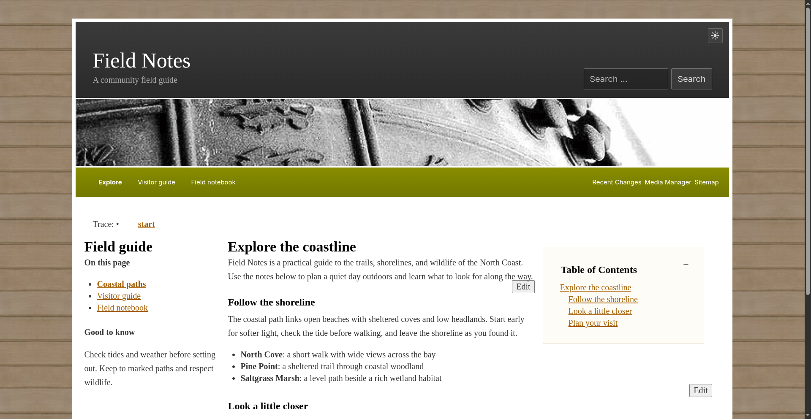
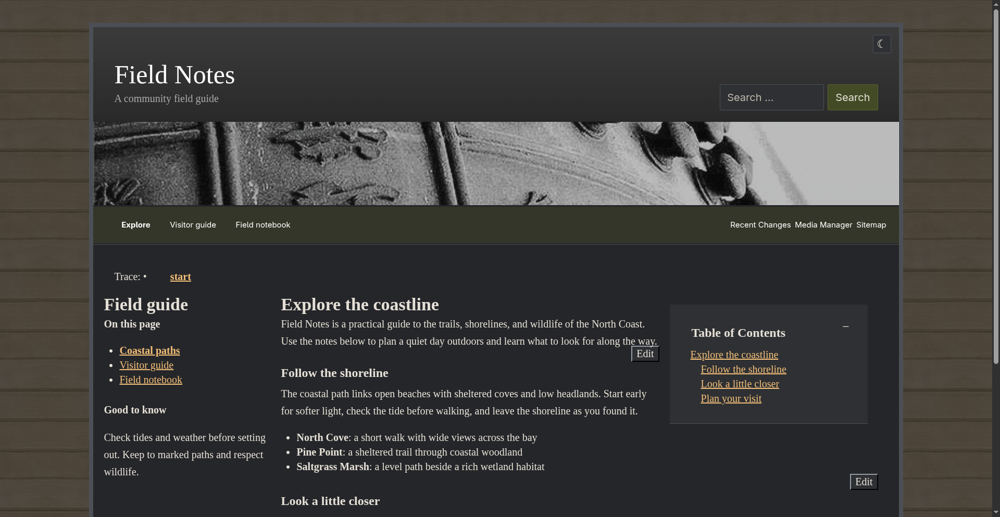
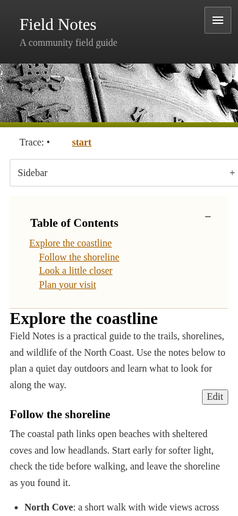
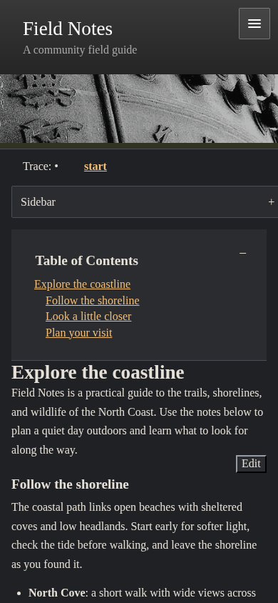

# Zenlike NG DokuWiki Template

Zenlike NG modernizes the existing Zenlike DokuWiki template. It preserves the
familiar prominent header, horizontal navigation, readable content area, and
optional sidebar while adding responsive mobile navigation and sidebar
controls, right-to-left support, and light, dark, or system-based appearance
modes.

The original Zenlike design was created by NodeThirtyThree and adapted for
DokuWiki by Dennis Ploeger. See the [original project](https://github.com/DRINGOT/dokuwiki-template-zenlike)
and the [DokuWiki template page](https://www.dokuwiki.org/template:zenlike).

## Screenshots

### Desktop

| Light mode                                                    | Dark mode                                                   |
| ------------------------------------------------------------- | ----------------------------------------------------------- |
|  |  |

### Mobile

| Light mode                                                                  | Dark mode                                                                 |
| --------------------------------------------------------------------------- | ------------------------------------------------------------------------- |
|  |  |

## Installation

Install a release from DokuWiki's Extension Manager, or download a ZIP from
the [GitHub releases](https://github.com/KristjanESPERANTO/dokuwiki-template-zenlikeng/releases)
and extract it into `lib/tpl/` in your DokuWiki installation. The archive
contains the `zenlikeng/` directory. After installation, select `zenlikeng` in
the Configuration Manager.

Zenlike NG uses the template ID `zenlikeng`, so it can be installed alongside
the original `zenlike` template. The two templates have separate settings;
settings from `zenlike` are not copied over.

## Configuration

You can change these options in the Configuration Manager:

| Setting          | Default           | Description                                                                                           |
| ---------------- | ----------------- | ----------------------------------------------------------------------------------------------------- |
| `menuid`         | `menu`            | Wiki page whose contents appear in the main navigation.                                               |
| `discussionPage` | `discussion:@ID@` | Discussion page pattern. `@ID@` stands for the current page ID; leave empty to hide discussion links. |
| `userPage`       | `user:@USER@:`    | User page pattern. `@USER@` stands for the logged-in username; leave empty to hide user-page links.   |
| `hideTools`      | `0`               | When enabled, hides user tools from visitors who are not logged in.                                   |
| `headerPicture`  | empty             | URL of the header image. Leave empty to use the default background.                                   |

## Sidebar

By default, the sidebar displays the `sidebar` wiki page.

## Requirements

Zenlike NG requires PHP 8.3 or newer and DokuWiki release 2026-07-14c ("Mort")
or newer. It uses the built-in `SiteMenu`, `UserMenu`, and `MobileMenu` classes.

## Support

Found a bug or have a question? Open an issue in the
[GitHub issue tracker](https://github.com/KristjanESPERANTO/dokuwiki-template-zenlikeng/issues).

## Development

See [CONTRIBUTING.md](CONTRIBUTING.md) for development and release instructions.
