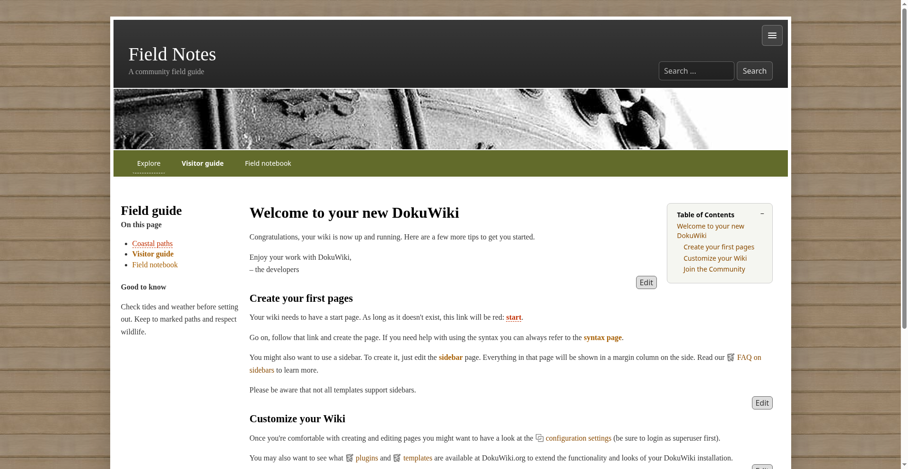
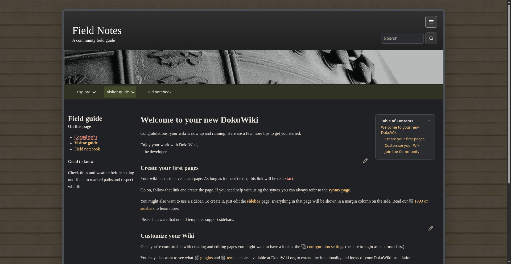
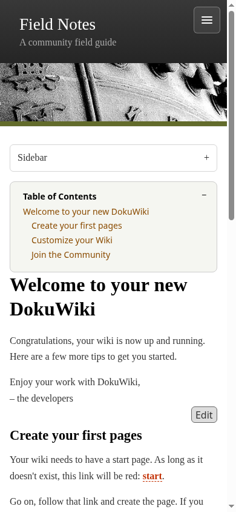
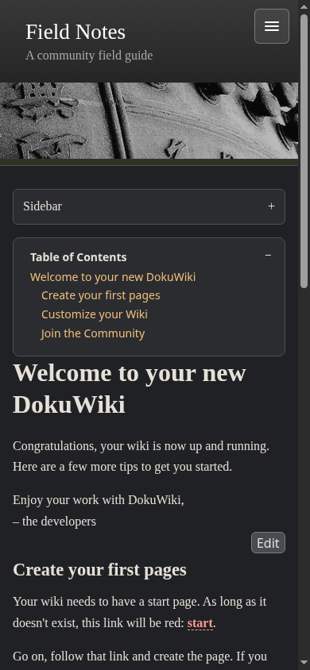

# Zenlike NG DokuWiki Template

Zenlike NG modernizes the existing Zenlike DokuWiki template. It preserves the
familiar prominent header, horizontal navigation, readable content area, and
optional sidebar while adding responsive mobile navigation and sidebar
controls, right-to-left support, and light, dark, or system-based appearance
modes.

The original Zenlike design was created by NodeThirtyThree and adapted for
DokuWiki by Dennis Ploeger. See the [original project](https://github.com/DRINGOT/dokuwiki-template-zenlike)
and the [DokuWiki template page](https://www.dokuwiki.org/template:zenlike).

Editor toolbar icons are from [Lucide](https://github.com/lucide-icons/lucide).
Their licenses are included in [images/toolbar/LICENSE](images/toolbar/LICENSE).

## Screenshots

### Desktop

| Light mode                                                    | Dark mode                                                   |
| ------------------------------------------------------------- | ----------------------------------------------------------- |
|  |  |

### Mobile

| Light mode                                                                  | Dark mode                                                                 |
| --------------------------------------------------------------------------- | ------------------------------------------------------------------------- |
|  |  |

## Installation

Install a release from DokuWiki's Extension Manager, or download a ZIP from
the [GitHub releases](https://github.com/KristjanESPERANTO/dokuwiki-template-zenlikeng/releases)
and extract it into `lib/tpl/` in your DokuWiki installation. The archive
contains the `zenlikeng/` directory. After installation, select `zenlikeng` in
the Configuration Manager.

The latest release is always available at a fixed URL:
<https://github.com/KristjanESPERANTO/dokuwiki-template-zenlikeng/releases/latest/download/zenlikeng.zip>

Zenlike NG uses the template ID `zenlikeng`, so it can be installed alongside
the original `zenlike` template. The two templates have separate settings;
settings from `zenlike` are not copied over.

## Configuration

You can change these options in the Configuration Manager:

| Setting               | Default           | Description                                                                                                    |
| --------------------- | ----------------- | -------------------------------------------------------------------------------------------------------------- |
| `menuid`              | `menu`            | Wiki page whose contents appear in the main navigation.                                                        |
| `discussionPage`      | `discussion:@ID@` | Discussion page pattern. `@ID@` stands for the current page ID; leave empty to hide discussion links.          |
| `userPage`            | `user:@USER@:`    | User page pattern. `@USER@` stands for the logged-in username; leave empty to hide user-page links.            |
| `hideTools`           | `0`               | When enabled, hides user tools from visitors who are not logged in.                                            |
| `showHeaderPicture`   | `1`               | Show the picture below the title bar. Disable it to remove the picture entirely.                               |
| `headerPicture`       | empty             | URL of the header image. Leave empty to use the bundled image; ignored if the picture is hidden.               |
| `pageBackground`      | `texture`         | Background around the page: `texture` (bundled wood), `color` (from Styling) or `image` (custom).              |
| `pageBackgroundImage` | empty             | URL of the image for `image`. Relative URLs are resolved from the wiki root; without one, the texture is used. |
| `pageBackgroundSize`  | `fill`            | Display of a custom image: `fill` covers the window and stays fixed, `tile` repeats it at its size.            |

## Navigation

Edit the wiki page configured as `menuid` to create the navigation. Nested
lists become dropdowns; a parent can be a link or plain text:

```text
	* [[start|Explore]]
		* [[wiki:welcome|Visitor guide]]
		* [[wiki:syntax|Field notebook]]
	* More
		* [[other]]
```

With JavaScript, a linked parent opens its submenu and its original link
appears as the first entry. Without JavaScript, the parent remains a link and
the submenu links stay visible.

Internal wiki links in the menu are filtered for each visitor's read
permissions. A denied parent link hides its entire branch, and an empty
text-only group is removed. Links to pages that do not yet exist remain
visible when the visitor has read permission. External links are not filtered.

This filtering applies to ordinary wiki links in the menu's list syntax, not
links generated by plugins. It does not protect the menu page itself: anyone
allowed to read that page can see its source and entries.

## Styling

Colors, widths, and content and navigation font sizes can be changed in
DokuWiki's Template Styling admin page (`?do=admin&page=styling`).

The content and navigation font sizes (`__content_font_size__`, default `1em`, and
`__navigation_font_size__`, default `0.875em`) accept CSS sizes such as `1.1em`.

The submenu font size (`__submenu_font_size__`, default `0.7em`) accepts CSS
sizes; `em` values are relative to the main navigation font size.

The `__dark_*__` colors apply to dark mode only; switch the appearance to dark
to check them. 

About backgrounds, `__outer_background__` and `__dark_outer_background__` set the
color around the page, which is shown as is when `pageBackground` is `color`.
The page background is not shown on small screens.  
The header background and text colors can be configured separately for light
and dark mode.  
Check text and control contrast at both ends of the header
gradient when choosing custom colors.

## Sidebar

By default, the sidebar displays the `sidebar` wiki page.

## Requirements

Zenlike NG requires PHP 8.3 or newer and DokuWiki release 2026-07-14c ("Mort")
or newer. It uses the built-in `SiteMenu`, `UserMenu`, and `MobileMenu` classes.

## Support

Found a bug or have a question? Open an issue in the
[GitHub issue tracker](https://github.com/KristjanESPERANTO/dokuwiki-template-zenlikeng/issues).

## Development

See [CONTRIBUTING.md](CONTRIBUTING.md) for development and release instructions.
